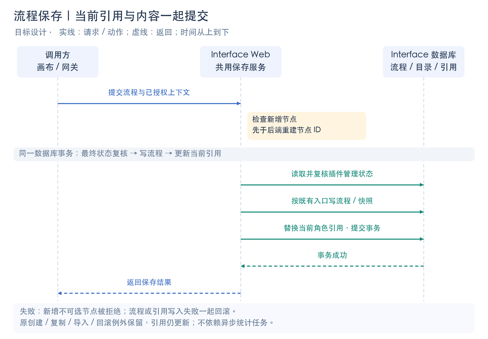
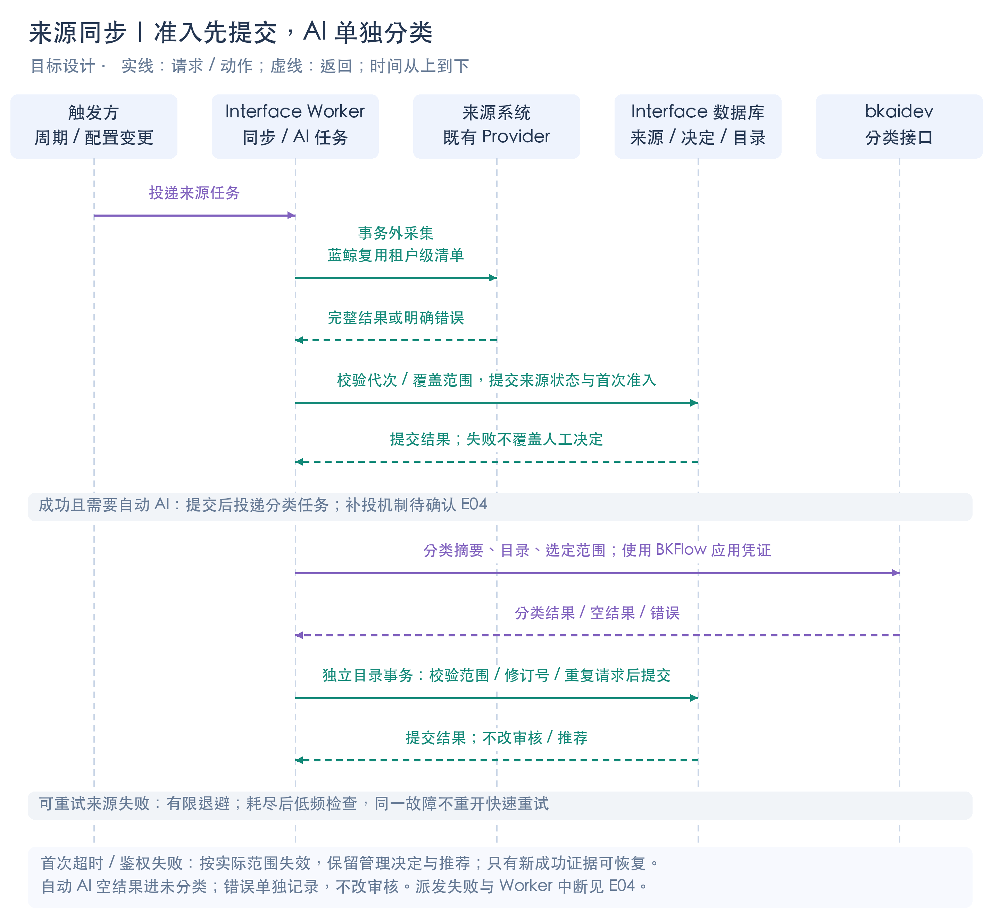
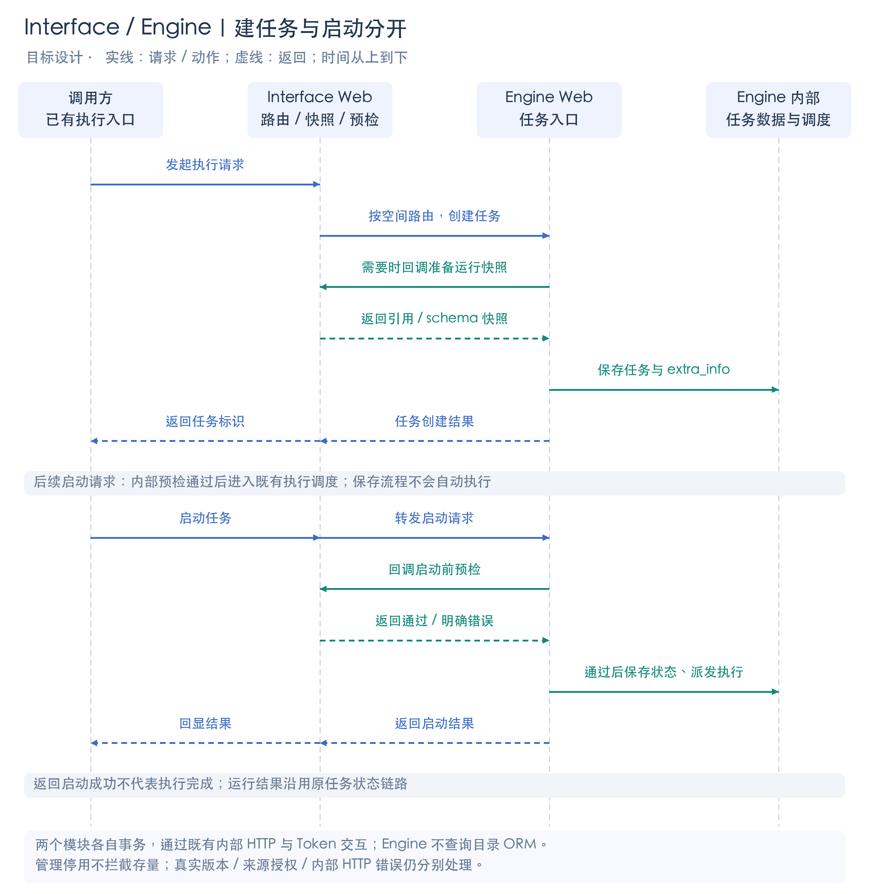

# 05 调用时序与一致性

[改动总览](2026-10-30-space-plugin-catalog-v2-review-design.md) · [接口与权限](2026-10-30-space-plugin-catalog-v2-contracts.md) · [任务与发布](2026-10-30-space-plugin-catalog-v2-jobs-migration.md) · [实施与待确认](../plans/2026-10-30-space-plugin-catalog-v2-team-plan.md)

以下为目标设计。实线表示请求/动作，虚线表示返回；图中标明的待确认项不视为已实现机制。

## 1. 保存流程与更新引用

新增节点判断发生在后端重建 ID 之前；最终状态复核、流程内容和引用索引写入处于 Interface 同一事务。当前引用不交给异步统计任务；发布/回滚/删除接在各自最终写入处。原整流程新建、复制、导入、网关创建及回滚例外保留，引用仍须更新。

## 2. 来源同步、有限恢复与自动 AI

蓝鲸插件复用租户级采集结果，不为每空间重复抓取。来源准入与分类提交分开；AI 不参与审核。首个超时/鉴权失败按覆盖范围失效并保留管理决定与推荐；可重试故障有限退避，耗尽后正常低频检查，只有新成功证据才能恢复。

图中提交后投递的执行顺序已明确；投递失败如何补投、Worker 中断怎样恢复、新空间失败从哪里重试仍为 E04，不能将图中的箭头当成可靠交付机制已经完成。

## 3. Interface / Engine 建任务与启动

Engine 根据现有快照是否足够决定是否准备快照；已有启动预检继续存在，但需拆开管理停用、同步故障与真实版本/授权失败。内部 HTTP 不通沿用既有错误路径，不把“存量允许运行”扩展为新增离线运行能力。两种数据库隔离形态都通过内部 HTTP，不共享目录 ORM。

## 4. 事务与失败处理

| 动作 | 事务与成功边界 | 失败 / 重复 / 并发处理 |
| --- | --- | --- |
| 目录保存、启停与推荐 | Interface 同库事务：空间配置行锁 → 相关对象 → 校验 revision/状态/推荐额度 → 写入及变更记录 | 冲突返回 409；超限整批拒绝；异常整笔回滚。网络请求不放入事务 |
| 流程最终保存 | 新增节点判断先于服务端 ID 重建；最终状态复核、流程写入和当前引用更新在同一事务 | 状态在检查后变化不能放行新节点；流程或引用任一失败一起回滚；发布/回滚/删除也接最终写入处 |
| 来源同步 | 网络采集在事务外；提交时检查来源配置和采集代次，完整成功结果才用于判定删除 | 首次超时/鉴权失败按实际覆盖范围失效；部分分页不宣告删除；过期结果丢弃；不覆盖人工设置 |
| 自动 AI | 来源准入先提交；分类任务请求 LLM 后，再以独立目录事务校验范围、policy_revision、directory_revision 和重复请求 | 空结果入未分类；错误与空结果分开记录，不改审核；晚到/重复结果不覆盖。提交后派发失败的补投方式待确认 E04 |
| 手动 AI | 不写正式目录；只返回 patch/empty/error，前端修改编辑副本；用户保存才走目录事务 | 空不动、失败报错；撤销回到 AI 前完整副本；保存清撤销；晚到结果丢弃。HTTP 超时链路待联调 E05 |
| 存量 / 新空间初始化 | 来源预采集在事务外；按空间写目录、管理设置、引用及 ready；旧管理配置快照和结果进入变更记录 | 单空间失败回滚，其他成功空间保留；ready 空间重跑跳过。失败状态另行记录的具体顺序见 E02；新空间失败再调度见 E04 |
| Interface → Engine 建任务 / 启动 | 两个模块各自事务；既有内部 HTTP 传递快照/预检结果；无跨模块原子提交 | 超时不代表 Engine 一定未建任务，不盲目重复创建；保留既有错误路径。管理停用允许存量运行不等于支持 Interface 离线启动 |
| DB 提交成功、队列派发失败 | 数据已提交与任务已投递必须分别记录 | 不能对外声称后台工作已完成；补投触发、持久化落点、去重及失败耗尽入口待确认 E04，不预设通用 Outbox 或无限重试 |

## 5. 前端副本与人工 AI

| 时刻 | 状态与结果 |
| --- | --- |
| 手工整理目录 | 只改当前编辑副本，保留已保存 revision |
| 点击 AI | 发送当前副本与选定范围；Web 返回 patch/empty/error，具体请求时限见 E05 |
| 收到合法结果 | 自动调整当前副本并保存完整 AI 前状态；空结果不动，失败提示错误 |
| 撤销 / 保存 | 撤销完整回到 AI 前；保存成功写正式目录并清撤销记录 |
| 请求晚到 / 他人已保存 | 过期结果不覆盖新副本或已保存结果；revision 冲突明确提示 |

自动 AI 由后台独立目录事务提交，人工 AI 由用户保存后提交；二者不共享“收到模型结果就写正式目录”的路径。第 6、7 项交互仍暂定。
