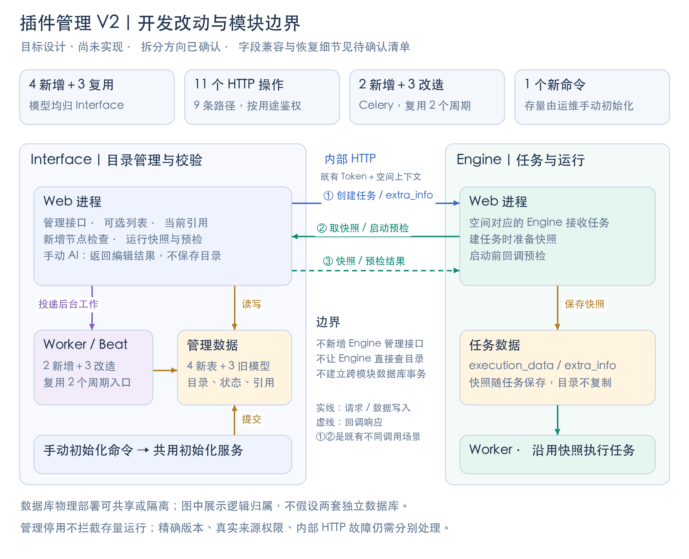

# 01 开发改动总览

2026年10月30日 · 开发评审稿，尚未实现。按用户已确认的复用收敛方案同步 spec/plan；字段兼容、补投和发布细节继续标注待确认。

[02 模型与接口](2026-10-30-space-plugin-catalog-v2-contracts.md) · [03 后台任务与迁移](2026-10-30-space-plugin-catalog-v2-jobs-migration.md) · [04 实施与验收](../plans/2026-10-30-space-plugin-catalog-v2-team-plan.md) · [05 调用时序](2026-10-30-space-plugin-catalog-v2-interactions-design.md) · [主仓文档分支](https://github.com/TencentBlueKing/BKFlow/tree/ai/space-plugin-catalog-v2-docs)

## 改动规模，一页看清

| 项目 | 当前设计数量 | 统计边界 |
| --- | --- | --- |
| Django model | **4 新增＋3 复用/扩展** | 新目录/引用/同步状态/变更记录 4 表；复用 SpaceConfig，扩展两张旧插件表 |
| HTTP 接口 | **新增 11 个操作 / 9 条路径** | 按“方法＋路径”计数；含存量状态查询；管理与使用侧权限分开，新增对外 APIGW 管理接口 0 个 |
| Celery | **新增 2 个、改造 3 个** | 补计既有蓝鲸同步；自动 AI 与新空间初始化新增，见第 03 页 |
| 定时调度 | **复用现有 2 个 Beat 入口** | 目录同步＋蓝鲸同步；不新增周期入口 |
| 初始化 | **新增 1 个 management command** | 预览、指定空间、全量和重跑共用一个命令；migrate 只建表 |
| 部署 / Engine | **新增服务 0 个；新增 Engine 管理接口 0 个** | 复用现有 Web、Worker、内部 HTTP 和快照 |

## 代码大概改在哪里

路径以仓库根目录为起点。下表统计模块范围；包含条件改动，不能相加当作最终文件数。

| 区域 | 新增 / 修改落点 | 具体变化 |
| --- | --- | --- |
| 新后端模块 | 新增 bkflow/plugin_catalog/ | 4 个新 models、身份与状态、目录/策略/推荐、来源采集、引用、选择、保存检查、AI；含 views、serializers、urls、tasks |
| 模块注册与配置 | module_settings.py、env.py、config/default.py、requirements.txt | 仅 Interface 注册新 app；来源重试、LLM 配置；拼音排序依赖 |
| 旧表与插件能力 | bkflow/plugin/models.py、space/configs.py；plugin/services/ 下 schema/detail、open_plugin_catalog、open_plugin_snapshot；plugin/tasks.py、bk_plugin/tasks.py、views/plugin.py、views/internal.py | 可选列表与存量详情分开；旧 V4 管理委托；区分管理停用、同步失败和真实版本错误 |
| 流程写入 | bkflow/template/models.py、serializers/template.py、views/template.py | 当前引用随保存/发布/回滚等事务更新；新增节点检查放在重建 ID 前 |
| 空间与网关 | bkflow/space/views.py；bkflow/apigw/views/ 下 create_space、renew_space_config、list_plugins、get_plugin_schema 及流程生命周期入口 | 新空间初始化、旧写入约束、列表过滤、统一保存检查；同步网关资源与文档 |
| 管理前端 | 新增 frontend/src/views/admin/PluginCatalog/、store/modules/pluginCatalog.js；修改空间入口和 i18n | 目录、策略、四状态、启停、推荐、引用和 AI |
| 两套画布 | common/TemplateCanvas/PalettePanel/NodeMenu/、canvas/ProcessCanvas/components/dnd/NodeMenu/；TemplateEdit/index.vue、NodeConfig/NodeConfig.vue、store/modules/plugin.js | 同一选择口径、准确版本定位、替换/换版本参数保留 |
| Engine 相关回归 | bkflow/task/open_plugin_snapshots.py、operations.py、celery/tasks.py；contrib/api/collections/interface.py、task.py | 核对快照准备、建任务、启动/调试；只在契约变化需要时改调用方，不新增目录 ORM |
| 测试与交付 | tests/interface/plugin_catalog/、受影响 Interface/Engine 测试、frontend/tests/；docs/guide/plugin_catalog_operations.md | 状态/并发/迁移/页面验证，初始化与回退手册 |

## Interface / Engine 形态如何影响设计

| 现有形态或调用链 | 本功能必须据此处理 |
| --- | --- |
| 同一套源码，Interface 与 Engine 是不同运行模块 | 4 个新 model 与复用的 3 个模型均归 Interface；目录、策略、审核和推荐由它保存 |
| only_calculation 可共享数据库；all_resource 才切换独立数据库 | 不假定数据库必然独立，也不借共享库让 Engine 直接查目录表；两种模式保持同一内部 API 边界 |
| Interface 按空间 ModuleInfo 选择 Engine；双方通过 HTTP＋内部 Token 调用 | 保留空间、租户和既有认证上下文；目录配置不下发成 Engine 上的第二份管理数据 |
| 画布保存发生在 Interface，建任务后 Engine 保存 execution_data / extra_info | 新增节点检查和当前引用在 Interface 写入事务内完成；运行快照随任务交接。当前引用不是 Engine 运行次数 |
| Engine 已有“取开放插件快照”“启动前预检”回调 | 调整 Interface 校验含义：管理停用或同步超时不能重新挡住存量运行；精确版本、真实来源及权限错误仍保留 |
| 跨模块 HTTP 不在同一数据库事务内 | 不宣称目录更新与 Engine 建任务整体原子提交；复用现有错误返回，不盲目重试有任务写入的创建调用 |
| Interface 不可达与“插件同步超时”是不同故障 | “存量不因停用而被拦截”不等于新增离线启动能力；原快照准备/预检 HTTP 失败仍有独立错误路径 |

**需要回归的既有内部入口：** POST api/plugin/internal/build_open_plugin_snapshots/、POST api/plugin/internal/validate_open_plugins_for_start/、POST api/template/internal/prepare_task_extra_info/。它们不计入 11 个新增 HTTP 操作；参数见第 02 页。

## 依据和未定边界

- 产品依据：[V2 需求](https://doc.weixin.qq.com/smartpage/a1_AJwA_wYsACkCNl2LM3D85TOuW0f3F?p=R0StK5)、[当前设计稿入口](https://www.figma.com/design/2cg4kWEI4NJF6UXtNcZJdf/BKFlow?node-id=2022-19178)；关联 [TAPD 插件管理需求](https://tapd.woa.com/70120217/prong/stories/view/139209730)。本轮按现有 spec 整理工程清单，未重新审阅 Figma。
- [完整 spec](https://github.com/TencentBlueKing/BKFlow/blob/ai/space-plugin-catalog-v2-docs/docs/specs/2026-10-30-space-plugin-catalog-v2-design.md)保留业务规则；[详细 plan](https://github.com/TencentBlueKing/BKFlow/blob/ai/space-plugin-catalog-v2-docs/docs/plans/2026-10-30-space-plugin-catalog-v2.md)保留 16 项代码任务与测试命令。
- 本轮源码证据：module_settings.py 的两种隔离模式、plugin/tasks.py 的两个任务及 bk_plugin/tasks.py 的蓝鲸同步、plugin/views/internal.py 的内部接口、task/open_plugin_snapshots.py 和 task/operations.py 的回调。初版基线为 6098d9d0，本轮已与 upstream/master 19de2149 对照；不代表线上已发布。
- 快捷改目录的保存时机（第 6 项）、批量启用的逐项目录确认（第 7 项）继续暂定；联系字段/替换文案仍为建议。未定字段、任务补投、授权上下文和发布细节用 E01—E08 集中跟踪，未自行升级为最终规则。

## 数量之外，开发需要看什么

| 内容 | 阅读位置 | 用来解决什么 |
| --- | --- | --- |
| 模型复用、接口参数、权限矩阵 | 第 02 页 | 旧表如何扩展、谁能调用、哪个数据是最终依据 |
| 任务触发、命令、发布兼容 | 第 03 页 | 是否重复采集、何时初始化、新旧读写如何接续 |
| 依赖、验收、E01—E08 待确认 | 第 04 页 | 哪些可实施、哪些不能自行定案 |
| 关键调用时序、事务和失败处理 | 第 05 页 | 谁先提交、哪里异步、失败保留什么、哪些恢复机制未定 |

容量与索引、批量/CSV 性能、缓存生效、AI 请求链路超时也纳入 E05/E07 和验收；本轮不编造容量或时延承诺。
