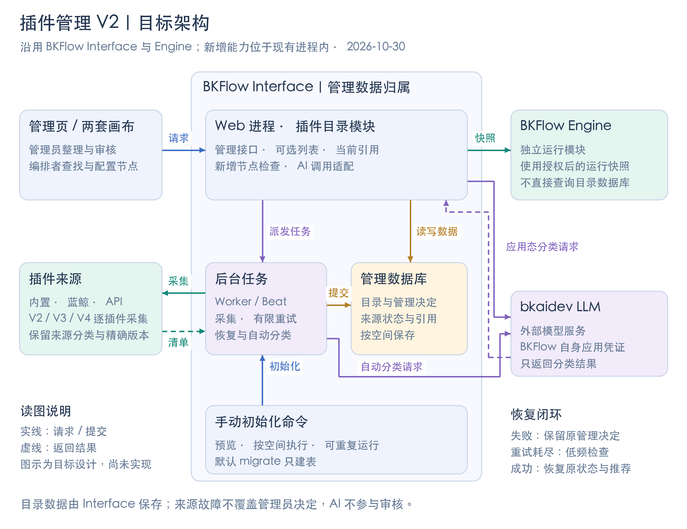

# BKFlow 插件管理 V2 开发设计

本文面向产品、前后端开发、测试和发布人员，用于共同评审实现方案。日期：2026年10月30日。当前阶段为开发设计与实现计划，尚未完成业务实现或环境验收。

依据：[插件管理 V2 需求](https://doc.weixin.qq.com/smartpage/a1_AJwA_wYsACkCNl2LM3D85TOuW0f3F?p=R0StK5)、[设计稿入口](https://www.figma.com/design/2cg4kWEI4NJF6UXtNcZJdf/BKFlow?node-id=2022-19178)、本轮已确认的技术取舍。关联需求：[插件管理](https://tapd.woa.com/70120217/prong/stories/view/139209730)。

最新确认覆盖需求旧文案：存量空间改用独立命令手动初始化，不放入默认 `migrate`；快速重试用尽后保留低频恢复检查；线上少量旧 scope 限制单独兼容。第 6、7 项交互继续“暂定”。

## 一、这次要交付什么

所有空间默认具有插件管理。管理员用同一套目录、审核、启停和推荐能力管理内置插件、蓝鲸插件与 V2/V3/V4 API 插件；编排者在两套画布中看到一致的可选插件。已有流程继续保留查看、编辑和运行能力，新增不可选插件节点在保存时被拦截。

| 对象 | 本期交付 | 重要边界 |
| --- | --- | --- |
| 管理员 | 两级目录、批量移动、审核启停、新插件策略、推荐、当前引用、AI 分类 | 没有空间总开关、隐藏状态、失效清理或手工插件排序 |
| 编排者 | 目录与类型筛选、名称/code 搜索、推荐优先排序、停用原因、替换与换版本参数保留 | 详情和版本读取不依赖“当前可选列表” |
| 接入系统 | 网关列表按空间过滤，流程保存与画布使用同一套检查 | 不新增开放的目录管理 API；整流程创建等例外保留 |
| 发布人员 | 初始化预览、手动命令、旧配置快照、失败回滚、可重复执行 | 默认 `migrate` 只建表，新空间自动初始化 |

历史引用查询、收藏、最近使用、独立审计页面及配置导入导出不在本期。

## 二、架构与职责

新增 `bkflow.plugin_catalog` 模块，部署在已有 Interface 中。沿用 Django/DRF、MySQL、Celery 和 Vue，不增加独立服务。



| 部分 | 负责的事情 | 不承担的事情 |
| --- | --- | --- |
| Interface Web | 管理接口、可选列表、引用查询、保存新增节点检查、人工 AI 请求 | 不根据前端计数决定推荐额度或是否允许保存 |
| Interface 后台任务 | 来源采集、有限重试、低频恢复检查、自动分类、新空间初始化 | 不用来源刷新覆盖管理员决定 |
| Interface 数据库 | 目录、管理决定、来源信息、当前引用和初始化记录 | 不直接调度任务；缓存失效不等于管理数据丢失 |
| Engine | 通过已有内部接口获取授权后的运行快照，执行任务与调试 | 不直接查新目录表，不把空间停用重新变成存量运行门槛 |
| 插件来源 | 提供真实元信息、分类、版本和执行能力 | 来源分类变化不自动重排管理员已经整理的目录 |
| bkaidev | 返回分类建议 | 不决定审核、启用、推荐或停用状态 |

管理权限继续使用现有平台管理员/空间管理员规则。先验证租户和空间，再判断管理员权限；批量对象、替换对象、引用详情和 CSV 都不能跨空间越权。

## 三、核心数据怎么保存

### 3.1 插件身份与版本分开

同一个插件不同版本属于同一管理对象。内置插件按 code、蓝鲸插件按插件 code、API 插件按来源与 API 标识识别。目录、节点名称和版本都不参与插件身份。

两个来源中同名或同 API 标识的插件不能合并；元信息不足以确定身份的老 API 不伪造身份，在“已失效”页独立提示并定位流程节点，不混入单插件统计。

### 3.2 主要对象

| 数据对象 | 主要内容 | 为什么要单独保存 |
| --- | --- | --- |
| 空间目录配置 `SpaceCatalogConfig` | 新插件策略、条件组、AI 范围、修订号、初始化进度 | 管理并发和初始化进度；没有整体启停字段 |
| 插件清单 `PluginInventory` | 身份、类型、来源、名称/code、来源分类、版本摘要、来源有效性和原因 | 来源故障后仍能保留插件及真实原因 |
| 空间管理设置 `SpacePluginSetting` | 启用/待审核/未启用、是否曾启用、目录、审核目标、推荐、停用原因和替换建议 | 来源同步不覆盖管理员操作 |
| 两级目录 `PluginDirectory` | 父目录、名称、同级顺序、系统标记 | 根目录与子目录都保证同级唯一，系统未分类受保护 |
| 当前引用 `TemplatePluginReference` | 流程、当前内容角色、快照、节点路径/名称和插件版本 | 发布与草稿分别展示，流程数量去重 |
| 老 API 诊断 `UnresolvedApiReference` | 无法识别的流程、快照、节点及原因 | 独立定位问题，不制造虚假的插件对象 |
| 初始化与同步记录 | 旧配置快照、执行结果、来源采集代次、故障轮次、重试次数和下次时间 | 支持失败重跑、恢复判断和过期结果拦截 |
| 变更记录 | 谁、何时、因何方式调整目录或管理设置 | 能区分来源分类、手工、AI、策略、未分类等去向；本期不增加审计页面 |

旧 scope 配置仅在检测到真实限制的少量空间单独处理，复用既有解析逻辑并核对迁移前后范围，不建设新的 scope 配置界面或全量映射表。

## 四、状态、推荐与来源恢复

### 4.1 四种界面状态来自两个独立维度

管理决定保存“启用、待审核、未启用”；来源有效性另外保存。来源失效时界面显示“已失效”，但原管理决定和推荐仍保留。

| 事件 | 管理决定 | 来源有效性 | 推荐 |
| --- | --- | --- | --- |
| 新插件首次发现 | 根据当时的新插件策略决定 | 记录本次来源结果 | 不自动推荐 |
| 管理员启用/审核不启用 | 改为启用/未启用 | 不修改 | 不自动推荐 |
| 管理员主动停用 | 改为未启用 | 不修改 | 清除并释放名额 |
| 首次超时、鉴权失败、确认来源删除 | 保持原决定 | 改为失效并保存原因 | 保留且继续占名额 |
| 来源重新成功 | 保持原决定，不重新审核 | 按新证据恢复 | 保留原推荐 |
| 切换新插件策略 | 存量不变 | 不修改 | 不修改 |

因此，原来启用的恢复为启用，原来待审核的恢复为待审核，原来未启用的恢复为未启用。任务结束或重试耗尽都不能当成恢复证据。

### 4.2 采集完整性与错误范围

内置、蓝鲸、V2/V3/V4 API 都进入逐插件清单。API 来源需要遍历所有配置和全部分页，不能把默认来源的前 200 条当成完整结果。

只有完整、成功且覆盖范围明确的清单，才能用“没有出现”判断删除。某一页超时导致未取到的条目不能被判为删除；超时/鉴权失败仍按本次请求覆盖范围标为相应原因失效。单插件失败只影响该插件，整个来源请求失败只影响该请求覆盖的插件。

| 错误类别 | 快速重试处理 |
| --- | --- |
| 超时、连接类暂时故障 | 有限指数退避 |
| 鉴权失败 | 不用相同无效凭证连续快速重试；配置变化后重新检查 |
| 已确认删除 | 不对同一删除结论快速重试，后续正常采集仍可发现恢复 |
| 限流、临时服务错误 | 根据来源明确的协议判断是否可重试，不冒充删除 |
| 协议错误、分页不完整 | 不提交半套快照，不盲目重试 |

实现默认值为首次请求之外最多重试 3 次，等待 10/20/40 秒，可加不超过 20% 的抖动，一轮最长 5 分钟。次数或时限耗尽后结束快速重试，保留低频正常检查；同一持续故障中的检查失败不会重新开启快速重试。成功结束本次故障，后续新故障可以开始新的有限重试。

### 4.3 推荐与排序

每空间最多推荐 10 个插件，包含失效但仍被推荐的插件。批量推荐超过剩余名额时整批拒绝；重复推荐不重复计数。停用释放名额，重新启用不自动恢复曾经主动取消的推荐。

所有排序都先推荐组、再普通组，两组分别按用户选择的字段和方向排序。名称按拼音，发布时间取最新版本的真实发布时间，被流程引用数取当前去重流程数；不使用运行次数。实现采用插件身份作同值稳定排序，缺失时间不伪造、放在末尾。

## 五、目录、新插件策略与 AI

### 5.1 目录调整一次提交

目录批量页维护独立编辑副本，人工和 AI 修改都进入这个副本，点击保存才提交。服务端统一检查两级、同级唯一、对象归属、系统目录保护以及修订号。

- 新根目录在根层最下面；新建子目录需要选择父目录，默认追加到该父目录最下面。
- 支持多选子目录移动到另一个父目录，也支持多选插件移动到指定目录。
- 删除目录时，子目录提升为一级；直接插件包含未启用插件移入未分类；子目录里的插件保持归属。
- 未启用插件再启用时，回填当前保留的目录；原目录已删除的回填未分类。
- 提升后产生重名等冲突时明确提示，不自行合并或改名。其他人已经保存了新内容时提示冲突，不静默覆盖。

### 5.2 三种新插件策略

| 策略 | 新插件准入 | 分类去向 |
| --- | --- | --- |
| 全部直接启用，默认 | 在原平台准入范围内启用 | 默认沿来源分类；管理员配置其他方式时按配置 |
| 全部需要审核 | 进入待审核 | 人工启用前确认目标目录，审核入口默认未分类 |
| 设条件自动启用 | 满足来源条件的启用，其余待审核 | 按条件选择未分类、AI 或指定目录 |

同一来源不能被多个条件组重复选择。策略保存只影响后续新插件，不重新处理存量，也不改变已有待审核或未启用决定。

### 5.3 AI 只处理分类

人工触发 AI 有结果后自动调整当前副本，无结果不改变任何内容，失败提示错误。撤销恢复本次 AI 调整前的完整副本，不区分此前来自人工还是其他 AI；保存成功后移除本次撤销能力。旧请求晚到时不能覆盖已经修改或保存的新内容。

自动策略选择 AI 时，先确定是否启用，再决定目录；无分类结果进入未分类，不因此改为待审核。失败与空结果分开记录，不由 AI 改变审核结果。

“仅对增量分类”只能修改本次新增插件归属，不改存量目录结构；“完全自由”允许修改选定范围内的存量目录和归属，包括人工归类。提交前仍检查策略及目录修订号，两种模式都不能修改推荐、审核或停用配置。

### 5.4 bkaidev 接入

采用 [bkaidev 应用态 Chat Completion](https://bkapigw.woa.com/docs/api-docs/gateway/bkaidev?apiName=aidev_llm_gateway_chat_completion)，使用 BKFlow 自身 APP_CODE/SECRET_KEY，由服务端写入 `X-Bkapi-Authorization`。空间管理员不需要再维护一份凭证。

网关环境、模型和超时由部署配置提供。请求只包含分类所需的插件摘要、目录、范围和用户要求；返回结果经过字段、对象范围和目录约束校验后才能应用。凭证不返回浏览器，不写日志。

目前已核对接口地址及应用态认证说明，尚未使用真实应用凭证验证模型权限、响应样本或延迟。请求按非流式基础协议设计，不假定支持特定 JSON Schema 扩展；真实联调作为独立验收项。

## 六、当前引用与保存检查

### 6.1 引用详情回答“现在谁在使用”

启用版本管理的流程只统计当前发布版本和当前草稿。同一流程任一份引用就计一次；例如 6 个发布引用＋2 个仅草稿引用＝8 个当前引用流程。仅历史版本引用不在当前清单中。

| 情况 | 展示方式 |
| --- | --- |
| 发布版本和草稿都引用 | 流程计一次，两个版本分别显示节点数量和名称 |
| 只有草稿引用 | 命中“草稿”筛选；已经发布但未引用与尚未发布分别表达 |
| 草稿存在但未使用 | 显示未引用 |
| 没有草稿/没有发布版本 | 分别显示无草稿/尚未发布 |
| 未开启版本管理 | 只展示唯一当前内容，不虚构发布和草稿 |
| 统计未完成或失败 | 显示未就绪/错误，不显示为 0 |

节点名称通过悬浮查看并按对应版本定位；同名节点分别计数。发布入口打开指定发布快照，草稿入口编辑当前草稿，目标已经变化时提示刷新。现有编辑页会优先加载草稿，需要在引用入口显式选择版本，避免跳错内容。

保存、发布、回滚、删除、新建、复制、导入都在最终写入事务中更新当前引用。只统计本流程直接拥有的节点，不展开引用的其他流程重复累计。CSV 导出当前搜索和筛选的全部匹配结果，不限当前页。

### 6.2 新增判断按节点进行

服务端从数据库读取当前草稿和发布内容，按完整节点路径与插件身份匹配已有节点，在任何服务端节点 ID 重建前检查原始提交树。不能只比较插件集合或插件使用数量。

| 保存场景 | 结果 |
| --- | --- |
| 编辑已有停用节点的参数、位置 | 允许，保留提示 |
| 同一插件切换版本 | 不视为新增，仍执行原结构、版本与权限检查 |
| 已有同插件节点，又新增/复制出一个节点 | 新节点单独检查，不可选则拦截 |
| 节点 ID 不变，但改成另一个不可选插件 | 检查目标插件并拦截 |
| 新增待审核、未启用或同步失败而失效的插件节点 | 拦截保存并定位节点，待管理员启用/来源恢复 |
| 整流程新建、复制、导入、网关创建、回滚 | 保留既有例外，同时更新引用；不跳过租户、平台和结构检查 |

检查与保存之间要防止管理员并发停用穿透；相关命令按统一顺序锁空间管理记录和流程记录，在事务内复查。来源同步的有效性更新也遵守相同并发约束。

来源同步超时/鉴权导致失效、或空间内主动停用，不阻止存量节点编辑、建任务、启动和调试。真实来源调用失败、精确版本不可用、平台或租户权限不满足仍如实报错。

第三方调用方如果在提交前自行重建全部节点 ID，需要实际样本核验；本地 SDK 更新入口未发现主动重建行为。不能为兼容猜测而按插件数量放行新增节点。

## 七、接口与前后端协作

管理接口放在 `/api/plugin_catalog/spaces/{space_id}/` 下；使用侧复用现有插件列表、详情和流程更新入口。以下为开发接口设计，具体错误编号按项目规范注册。

| 接口能力 | 关键输入/输出 | 协作约束 |
| --- | --- | --- |
| 管理列表/状态批量读 | 状态、目录、类型、来源、搜索；返回状态原因、可用操作、推荐和引用数 | 管理搜索支持名称/描述/修改人；使用侧只搜名称/code |
| 目录读取/预览/保存 | 目录树、插件归属、审核目标、目录修订号 | 预览和保存使用同一个转换函数，批量页一次提交 |
| 新插件策略 | 模式、来源条件组、分类方式、AI 范围、策略修订号 | 同一来源条件互斥，存量不重跑 |
| 审核、启用、停用、停用配置 | 逐项插件和目标目录；可选原因及替换对象 | 原因最多 200 字；替换对象需当前可选且不能是自己 |
| 推荐/取消推荐 | 插件集合、管理修订号 | 后端事务核对含失效项的 10 个名额，超限整批拒绝 |
| AI 分类 | 当前编辑副本、范围、指令、请求标识 | 返回分类变更/空/错误；人工调用不直接保存正式目录 |
| 当前引用与 CSV | 插件身份、流程搜索、发布/仅草稿筛选 | 概览与列表筛选分开，CSV 不分页，节点保留版本归属 |
| 旧 API 诊断 | 无法识别身份的流程与节点 | 独立提示，不合并进插件数量 |
| 旧 V4 管理入口 | 保持原调用包络并委托新管理服务 | 旧启用表不继续作为另一套管理依据 |
| 旧空间配置写入 | 已完成初始化后拒绝写旧 space_plugin_config | 旧配置只读留存，界面提供前往插件管理入口 |

目录、策略和管理操作各带修订号；冲突返回明确错误，不静默最后写入覆盖。列表必须先完成准入、状态过滤和排序，再分页，避免返回不足一页或错误总数。

两套画布共用同一选择逻辑。详情、表单和版本走独立读取路径；替换插件只保留同名参数，同插件换版本仅在同 key 且表单类型相同的情况下保留值和变量关联。新参数按目标默认值处理，旧参数不带入，提供旧输入查看/复制与保留、待确认、丢弃数量。

凡改动现有网关接口，同次同步资源定义、中文接口文档和生成后的文档压缩包。新管理接口不因此自动开放给第三方应用。

## 八、初始化、发布与回退

### 8.1 存量采用独立命令

默认 `migrate` 只建立表结构和约束，不调用来源，不创建存量初始化任务，不回填目录或引用。拟定运维命令为 `initialize_plugin_catalog`，支持指定一个或多个空间、全部空间和只预览模式。

```bash
# 仅预览一个空间；这是命令设计示例，尚未实现
python manage.py initialize_plugin_catalog --space-id SPACE_ID --dry-run

# 初始化指定空间，或显式选择全部空间
python manage.py initialize_plugin_catalog --space-id SPACE_ID
python manage.py initialize_plugin_catalog --all-spaces
```

初始化先在事务外完成来源采集和兼容检查，再逐空间原子保存。完成的空间跳过，失败空间可重跑；一个空间失败不回滚其他成功空间，最终结果明确列出失败并返回非零状态。重跑不能重置管理员已保存的目录、推荐或启停决定。

初始化保留原平台准入和可选范围，不把存量重新送审；旧 V4 明确关闭记录迁为未启用。按来源原分类生成初始目录，保存旧配置快照并回填当前引用。少量真实 scope 例外单独核对，不要求普通管理员先清理配置。

新空间自动使用同一初始化服务，无需管理员手动运行命令。初始化进度属于内部就绪状态，不是产品开关。

### 8.2 发布步骤

1. 部署表结构及兼容读取能力，执行默认 `migrate` 建表。
2. 用独立命令预览，核对可选集合、V4 关闭项、来源分类、无法识别旧 API 和 scope 例外。
3. 手动执行初始化；失败空间排查后重跑，确认目录、管理设置和引用一起就绪。
4. 接通管理页、两套画布和网关入口，确认它们对同一空间使用一致规则。
5. 回归存量编辑、建任务、启动、调试及新增拦截，再完成目标环境验收。

未完成初始化的存量空间继续原读取路径，不因为新表为空而变成无可用插件；新管理写入和引用功能明确返回未就绪。新周期同步不能提前把这些存量当新插件重新审核。

失败回滚以空间事务和旧配置快照为基础。上线后已有新管理决定时，不能简单恢复旧快照覆盖它们；部署回退必须同时核对版本和数据，不提供用户“关闭管理、恢复旧配置”的入口。

## 九、实现安排与验收重点

详细实现计划拆为 16 项，每项包含修改文件、依赖、接口、失败测试、实现、验证和提交步骤。开发可按以下四批评审，功能入口需要整体联调后交付。

| 批次 | 内容 | 验证重点 |
| --- | --- | --- |
| 基础与同步，任务 1—5 | 身份/模型、目录、策略与推荐、全来源采集、重试恢复 | 多来源同 ID、全分页、并发推荐、晚到失败结果、重试终止 |
| 迁移与接口，任务 6—10 | 当前引用、手动初始化、可选列表、保存检查、管理接口兼容 | 生命周期更新、初始化重跑、scope 例外、节点 ID 重建、跨租户拒绝 |
| AI 与前端，任务 11—15 | bkaidev、目录编辑撤销、管理/策略、引用定位、两画布与参数 | AI 空/错/晚到、增量/自由模式、发布/草稿跳转、替换参数 |
| 联调与发布，任务 16 | 完整业务链路、接口文档、初始化和回退说明 | 模拟来源故障恢复、两套画布、真实 AI 联调、目标环境验收 |

必须串起来验证的场景：新插件进入待审核 → 管理员启用 → 推荐 → 来源首次超时进入失效且仍占推荐名额 → 低频成功检查恢复 → 主动停用释放名额 → 存量节点仍可编辑运行、新增节点保存被拒绝 → 删除目录移未分类 → 重新启用回填未分类。

测试使用独立测试数据库和模拟来源；本地测试、CI、真实 AI 联调、目标环境业务验收分别记录。当前没有把文档或图示当作任何一项实现验收结果。

## 十、仍需保留的暂定项与联调依赖

| 项目 | 当前状态 | 影响范围 |
| --- | --- | --- |
| 第 6 项：快捷修改目录和待审核目标目录的保存时机 | **暂定**：快捷入口即时保存，启用弹窗随确认保存 | 相关前端动作；目录批量页统一保存已确认 |
| 第 7 项：批量启用的目录确认 | **暂定**：逐项展示并保留目标目录，统一确认 | 批量启用交互及最终验收 |
| 联系字段与替换字段文案 | 创建人/最近修改人作为联系线索、替换插件选填仍属建议 | 页面和 CSV 不冒称维护人；不新增维护名单 |
| bkaidev 联调 | 服务与应用凭证方向已确认，真实模型/协议样本待验证 | 不影响模拟接口开发，真实 AI 验收单列 |
| 第三方自行重建节点 ID | SDK 入口未发现，实际调用样本待核验 | 发现具体实例再评审兼容，不降低新增检查 |

本轮低频恢复检查、独立手动初始化、scope 例外处理已经收敛，不再作为待确认问题。原需求文档中的旧 migrate 文字尚未在本轮回写，实施以本文记录的最新确认为准。

## 十一、交付材料与版本

- 开发规格：[spec](https://github.com/TencentBlueKing/bkflow/blob/ai/space-plugin-catalog-v2-docs/docs/specs/2026-10-30-space-plugin-catalog-v2-design.md)。
- 逐任务实现计划：[plan](https://github.com/TencentBlueKing/bkflow/blob/ai/space-plugin-catalog-v2-docs/docs/plans/2026-10-30-space-plugin-catalog-v2.md)。
- 本文对应的仓库评审稿：[团队评审稿](https://github.com/TencentBlueKing/bkflow/blob/ai/space-plugin-catalog-v2-docs/docs/specs/2026-10-30-space-plugin-catalog-v2-review-design.md)。
- 架构成图、预览及可编辑生成源：[架构图材料](https://github.com/TencentBlueKing/bkflow/tree/ai/space-plugin-catalog-v2-docs/docs/pics/plugin-catalog-v2)。
- 主仓文档分支：[ai/space-plugin-catalog-v2-docs](https://github.com/TencentBlueKing/bkflow/tree/ai/space-plugin-catalog-v2-docs)。源码分析基线为 `6098d9d0`；后续实现前按实际开发分支重新核对落点。

本文保留评审所需的数据、接口、异常和发布边界；具体逐行任务由 spec 和 plan 承接。旧设计中的隐藏、总开关、来源绑定、V2/V3 延后实现等表述不再作为本期依据。
